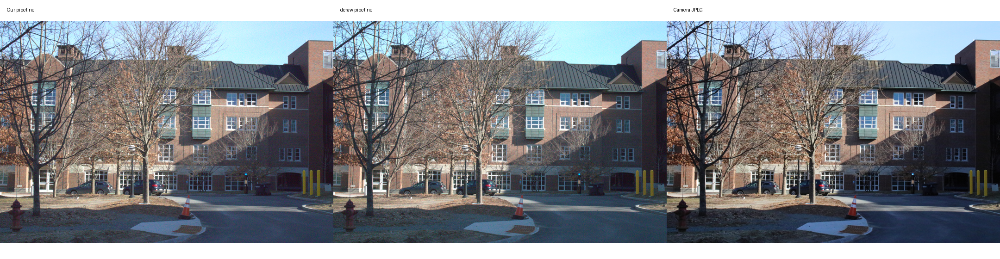

# RAW Image Development Pipeline

A Python pipeline that turns Bayer sensor measurements into display-ready sRGB images. It exposes each development stage so white balance, interpolation, color correction, and exposure decisions can be inspected independently.



Built by **Godwin Kangor** using Python, NumPy, SciPy, scikit-image, Matplotlib, and Pillow. RAW decoding and metadata extraction use the external `dcraw` command; the development stages are implemented in Python.

Read the [project case study](report.md) for the design, results, and tradeoffs.

## Capabilities

- Extract sensor metadata and preserve an unprocessed Bayer mosaic.
- Subtract black level, normalize sensor values, and compare four Bayer layouts.
- Compare camera, gray-world, white-world, and manually selected neutral-patch white balance.
- Reconstruct camera RGB with bilinear demosaicing, transform to linear sRGB, adjust brightness, and apply the piecewise sRGB transfer function.
- Export PNG/JPEG renderings, diagnostic previews, metadata, and isolated run manifests.
- Compare the custom rendering with dcraw and an in-camera JPEG.

## Run locally

Install Python 3.12 and `dcraw` (available separately from your system package manager). From the repository root:

```bash
python3 -m venv .venv
source .venv/bin/activate
python -m pip install -r requirements-raw.txt
python -m raw_pipeline.pipeline pipeline_config.json
```

Provide your own RAW file and update `pipeline_config.json`. The example expects `data/original/Thayer.CR2` and an optional paired `Thayer.JPG`; original inputs are not bundled. Paths resolve relative to the configuration file. Set the camera model, black/white metadata compatibility, Bayer layout, and appropriate camera coefficients for your input. The configured matrix and manual patch coordinates are specific to the demonstrated Canon EOS 2000D image. Remove `manual_patches` or supply new coordinates for a different scene; remove `camera_path` to skip the camera comparison.

Results go into a new directory under `outputs/runs/`. Full-resolution floating-point arrays can consume hundreds of megabytes per run. Diagnostic previews are reduced and clipped for display; they are not radiometric measurements.

## Validate

```bash
python -m unittest discover -s tests -v
```

Synthetic checks cover sensor linearization, Bayer reconstruction, white balance, color transforms, export round trips, configuration validation, and failure logging. They run without a RAW file or physical camera. Full RAW decoding additionally requires `dcraw` and an input file.

## Code map

| Module | Responsibility |
| --- | --- |
| `raw_conversion.py` | RAW copies, dcraw invocation, metadata and mosaic loading |
| `preprocessing.py` | Linearization and Bayer layout/masks |
| `white_balance.py` | Automatic and manual gains |
| `demosaic.py` | Bilinear color interpolation |
| `color.py` | Color-space conversion, brightness, sRGB encoding |
| `experiments.py` | Bayer, white-balance, and reference comparisons |
| `pipeline.py` | Configuration, orchestration, previews and exports |
| `error_handling.py` | Logged failures and exit status |

All modules are under `raw_pipeline/`. This project grew from a computational photography course exercise; this repository presents the engineering implementation and its observed limitations.
