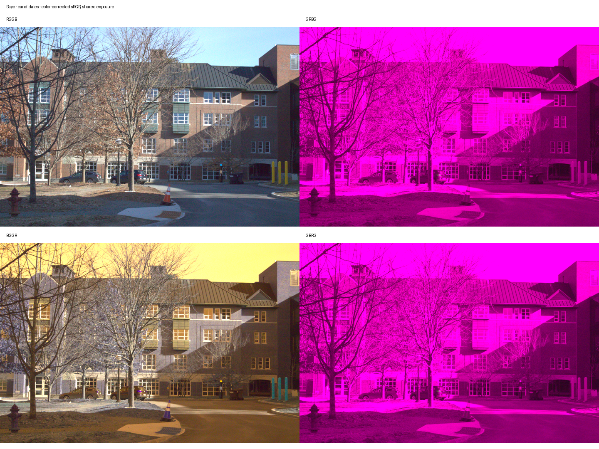
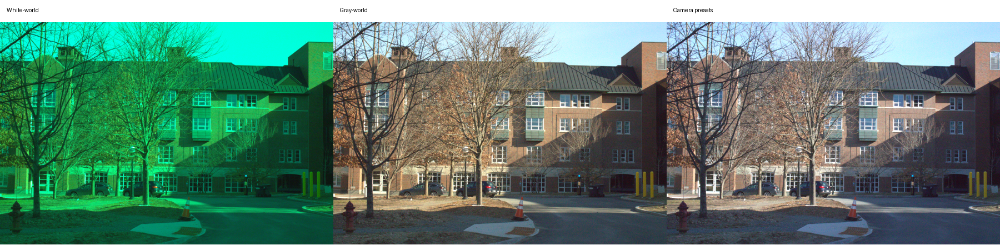
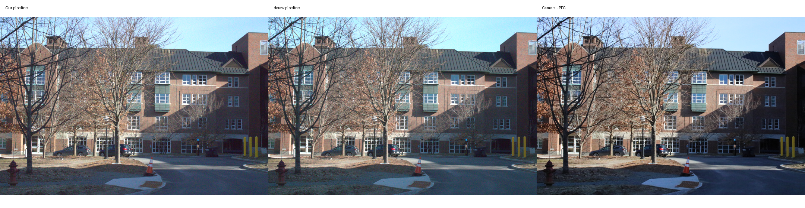

# From sensor measurements to sRGB

## Project overview

I built an inspectable RAW image development pipeline to understand and control the steps between a camera sensor measurement and a finished photograph. Instead of treating RAW conversion as a single library call, the project separates sensor normalization, white balance, demosaicing, color conversion, and display encoding into testable Python modules.

The demonstration uses a Canon EOS 2000D photograph of Thayer. The pipeline produces full-resolution PNG/JPEG renderings alongside intermediate previews and recorded processing settings. The implementation originated in computational photography coursework; the focus here is the system design and engineering results.

## Architecture

```text
RAW file + camera metadata
  → unprocessed Bayer mosaic
  → black-level subtraction and sensor-range normalization
  → white-balance gains on the linear mosaic
  → bilinear demosaicing into camera RGB
  → camera-to-linear-sRGB transform
  → brightness scaling and display clipping
  → piecewise sRGB encoding
  → 8-bit PNG and JPEG
```

`dcraw` supplies decoding and metadata; NumPy, SciPy, and scikit-image implement the development stages. Linear measurements stay separate from encoded display values. Each run has an isolated output directory, metadata, command logs, diagnostic images, and a manifest so a rendering can be traced to its settings.

## Sensor reconstruction

The input Bayer mosaic stores one filtered measurement per photosite. Black-level subtraction removes the sensor offset, and normalization expresses the signal relative to the usable sensor range. The pipeline supports RGGB, BGGR, GRBG, and GBRG layouts and can render all four candidates for visual comparison.

Bilinear demosaicing reconstructs the missing color components from the measured color lattices. This makes the implementation easy to inspect and validate, while retaining the expected limitations at sharp edges and fine textures.



## White balance and color

Camera presets, gray-world, and white-world methods are applied independently to the same linearized mosaic. Manual white balance estimates gains from a selected candidate neutral patch, with bounds and signal checks to reject unsuitable measurements.



For the demonstrated scene, camera white balance with a target brightness mean of 0.25 was selected for the automatic rendering. This is a scene-specific visual choice, not a universal optimum. Manual patch neutrality is not independently verified, so manual results remain comparisons rather than calibrated ground truth.

The camera transform uses nine coefficients from the Canon EOS 1500D entry in [dcraw's source](https://dechifro.org/dcraw/dcraw.c), corresponding to the EOS 2000D regional model name. The code combines the camera matrix with the sRGB/XYZ transform, normalizes the response, and inverts the resulting transform. Tests check neutral preservation and matrix orientation. Brightness scaling and the piecewise sRGB transfer function are applied after color correction.

## Results and reference comparison



The custom pipeline produces a 6020 × 4016 development for the supplied RAW capture. The paired camera JPEG is 6000 × 4000. The overview compares appearance; the frames are not registered and should not be treated as a pixelwise benchmark.

The dcraw reference uses camera gains, bilinear interpolation, sRGB output, disabled automatic brightening, and an explicit brightness multiplier matching the custom pipeline's numerical scale. Differences can still arise from decoder scaling, clipping, and internal processing. The camera's proprietary noise reduction and sharpening settings are not fully known. No claim of superior image quality or exact camera matching is made.

The pipeline also exports three manual-patch renderings and lossless PNG versus quality-95 JPEG comparisons. PNG export is checked by decoding it and comparing the quantized pixel values. JPEG is intentionally lossy.

## Reliability and reproducibility

- Configuration paths resolve against the JSON file rather than the shell's working directory.
- Camera-model checks help prevent accidental use of a mismatched color matrix.
- Each run preserves its inputs, processing settings, and intermediate outputs in an isolated directory.
- Image export refuses to overwrite an existing output file.
- Errors produce concise terminal messages, an appended error log, and a nonzero exit status.
- Synthetic unit tests exercise linearization, all Bayer layouts, interpolation, white balance, color transforms, brightness, transfer encoding, output formats, and error handling.

Run the checks using `python -m unittest discover -s tests -v`. These checks validate numerical and orchestration behavior; they do not replace visual evaluation or camera calibration.

## Tradeoffs and next steps

Full-resolution float64 camera RGB for this capture takes about 580 MB before other intermediates, making memory and disk usage practical constraints. Bilinear interpolation prioritizes clarity over edge-aware reconstruction. The pipeline does not include lens correction, advanced denoising, highlight recovery, or calibrated perceptual image-quality evaluation.

Useful extensions would include tiled processing, edge-aware demosaicing, measured camera calibration, and registered reference comparisons. The current project demonstrates the complete path from sensor samples to a display image with explicit, inspectable processing choices.

## Resume description

Built a modular Python RAW-to-sRGB imaging pipeline with Bayer reconstruction, automatic/manual white balance, camera color transforms, and reproducible PNG/JPEG exports; validated numerical stages with synthetic unit tests and compared output against dcraw and camera JPEG renderings.
